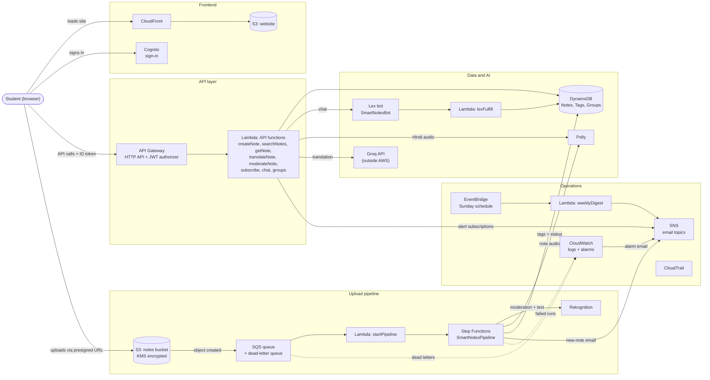
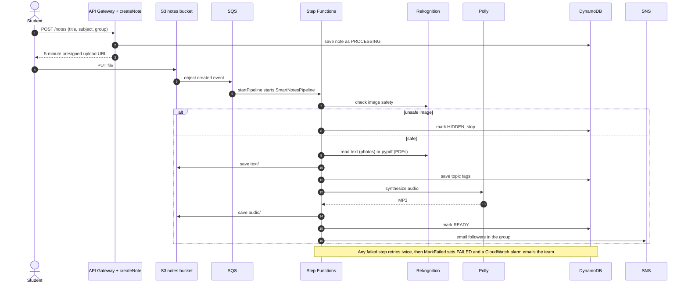

# Smart Notes

A serverless platform on AWS for sharing, searching and listening to class notes.

Upload a photo or PDF of notes into a private group. Smart Notes reads the text, tags the topics, records an audio version and emails group members who follow the subject. Notes can then be searched by topic, found through a chatbot, read in Hindi, Telugu or Tamil, and played aloud.

## Features

- **Private groups.** Create a group, share its 8-character invite code, and only members see its notes. The group's admin verifies or hides notes and can remove members.
- **Automatic processing.** Every upload is checked for unsafe images, read, tagged, turned into an MP3 and marked ready in about a minute.
- **Topic search.** Search by topic ("vpc peering", "deadlock") or browse by subject. Multi-word topics and acronyms like VPC and SQL are supported.
- **Assistant.** Ask "do we have notes on paging?" through an Amazon Lex chatbot.
- **Text and audio in four languages.** English text with Polly audio; Hindi translation with Polly audio; Telugu and Tamil translations read by the browser's voice.
- **Email alerts.** Follow subjects and get an email when a note is added to them in your groups, plus a weekly digest of the most-opened notes.

## Architecture

### Components



IAM roles, KMS encryption, CloudTrail auditing and the CloudFormation template apply across all of these.

### Processing an upload



Fully serverless, deployed in **ap-southeast-2 (Sydney)**. There are no EC2 instances, load balancers or VPC resources: Lambda runs the code, API Gateway and CloudFront handle traffic and scaling, and access is controlled with IAM, Cognito, private S3 buckets and KMS encryption.

## AWS services

| Service | Used for |
|---|---|
| S3 | Notes bucket (`notes/`, `text/`, `audio/`, `translated/`), website bucket, CloudTrail log bucket |
| CloudFront | Serves the website over HTTPS from the private site bucket |
| Cognito | Sign-up and sign-in; the ID token authorizes every API call |
| API Gateway | HTTP API with 14 routes, each protected by a Cognito JWT authorizer |
| Lambda | 19 Python functions: 8 behind the API, 8 in the pipeline, 3 others |
| SQS | Upload queue with a dead-letter queue |
| Step Functions | `SmartNotesPipeline`: runs the processing steps with retries |
| Rekognition | Image moderation and reading text from photos |
| Polly | English and Hindi audio (voice Kajal) |
| DynamoDB | `SmartNotes-Notes`, `SmartNotes-Tags`, `SmartNotes-Groups` |
| SNS | `new-notes` (filtered by subject and group), `ops-alerts`, `weekly-digest` |
| Lex | `SmartNotesBot`, `FindNotes` intent, fulfilled by `lexFulfill` |
| EventBridge | Sunday schedule that runs `weeklyDigest` |
| IAM | `smartnotesrole` with only the actions the functions use |
| KMS | SSE-KMS encryption on the notes bucket |
| CloudWatch | Logs for every function; alarms for failed runs and dead letters |
| CloudTrail | `smartnotes-trail`, audit log of every API call |
| CloudFormation | Template of all 39 resources, made with the IaC generator |

Outside AWS: **Groq** (model `openai/gpt-oss-120b`) for translation, the **pypdf** library for reading PDFs, and the browser's speech synthesis for Telugu and Tamil audio.

### Service substitutions

This deployment runs in an AWS account whose organization blocks Textract, Comprehend and Translate through a service control policy, so it uses alternatives:

| Usual service | Used instead |
|---|---|
| Textract | Rekognition `DetectText` for photos, pypdf for typed PDFs |
| Comprehend | Word-frequency tags (acronyms kept, filler words removed) |
| Translate | Groq API, cached after the first request. The code tries Translate first and falls back to Groq. |

## Repository layout

```
lambdas/<name>/lambda_function.py   one folder per Lambda function (19)
site/index.html                     the whole website (plain HTML, CSS and JavaScript)
vendor/pypdf/                       pypdf, bundled into pipeReadText
deploy/
  build.py                          zips the changed functions into deploy/build/
  1-pipeline-fix.sh                 pipeline and Rekognition text reading
  2-lex-bot.sh                      creates the Lex bot and connects the chat function
  3-cloudtrail.sh                   creates the CloudTrail trail and log bucket
  4-cloudformation.sh               generates the CloudFormation template
  5-groups.sh                       groups feature, new indexes and routes, website upload
  assign-notes.sh                   moves notes without a group into a group
  rollback.sh                       restores functions from saved backup versions
  smartnotesaccess-policy.json      the IAM policy for smartnotesrole
  SmartNotes-template.yaml          generated CloudFormation template
```

## Deploying changes

The scripts use an AWS CLI profile named `smartnotes` and check they are pointed at the right account before changing anything.

```bash
aws login --profile smartnotes --region ap-southeast-2   # sign in to the account
python3 deploy/build.py                                  # rebuild the function zips
```

Each deploy script saves a backup version of every function it changes. To undo:

```bash
deploy/rollback.sh                                  # functions changed by 1-pipeline-fix.sh
BACKUPS=backups-groups.txt deploy/rollback.sh       # functions changed by 5-groups.sh
```

To update only the website:

```bash
aws s3 cp site/index.html s3://smartnotes-site-<account-id>/index.html --profile smartnotes
aws cloudfront create-invalidation --distribution-id <id> --paths '/*' --profile smartnotes
```

### Translation key

`translateNote` reads its Groq settings from Lambda environment variables, never from code:

| Variable | Value |
|---|---|
| `GROQ_API_KEY` | a key from console.groq.com |
| `GROQ_MODEL` | `openai/gpt-oss-120b` |

## Known limits

- Rekognition reads about 100 words per photo, and messy handwriting comes out rough. Scanned PDFs are not read; typed PDFs are.
- Audio covers the first ~2,900 characters of a note (one Polly request).
- Polly has no Telugu or Tamil voice, so those depend on the viewer's device having one.
- Translation uses the first 6,000 characters of a note and is subject to Groq's free-tier rate limits.
